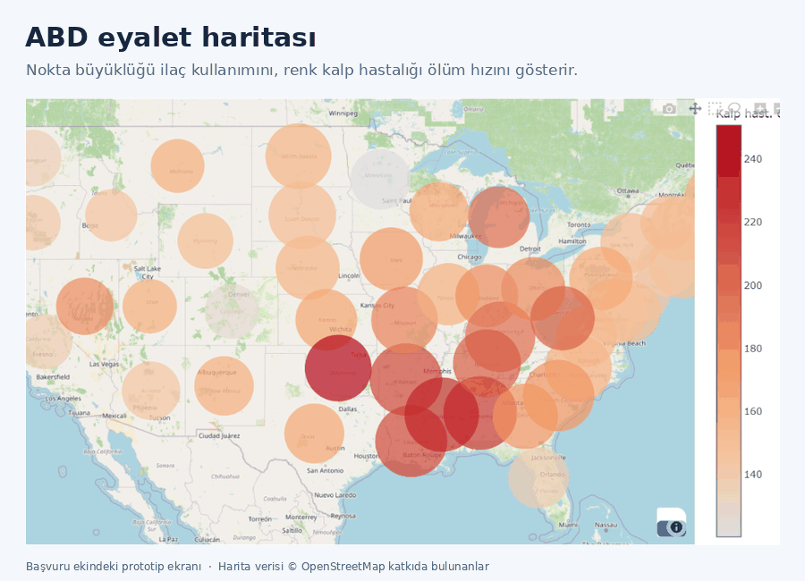

# Bölgesel Sağlık ve Çevre Göstergeleri

ABD’nin 50 eyaletinde hipertansiyonu olan yetişkinlerde tansiyon ilacı kullanımı, kalp hastalığı ölüm hızı ve PM2.5 düzeyini etkileşimli haritada bir araya getiren bir Flask prototipi.

## Demo



Haritada noktanın **büyüklüğü** ilaç kullanımı yüzdesini, **rengi** kalp hastalığı ölüm hızını gösterir. Bir noktanın üzerine gelince PM2.5 dahil üç gösterge okunabilir. Eyalet karşılaştırması seçilen eyaletin değerlerini, CSV’deki 50 eyaletin **eşit ağırlıklı ortalamasıyla** yan yana gösterir. PM2.5 yorumu, eyalet değeri ile bu ortalama arasındaki farka dayanır.

## Kurulum

Python 3.12 ile proje klasöründe aşağıdaki komutları çalıştırın.

**Windows PowerShell**

```powershell
python -m venv .venv
.\.venv\Scripts\python.exe -m pip install -r requirements.txt
.\.venv\Scripts\python.exe app.py
```

**Linux ve macOS**

```bash
python3 -m venv .venv
.venv/bin/python -m pip install -r requirements.txt
.venv/bin/python app.py
```

Tarayıcıda [http://127.0.0.1:5001](http://127.0.0.1:5001) adresini açın. Haritanın Plotly.js ve OpenStreetMap bileşenlerini yüklemesi için internet bağlantısı gerekir.

## Veriler

`data/uc_katmanli_eyalet_verisi.csv` prototipin kullandığı eyalet düzeyinde özet tablodur. Yıllar göstergeye göre değişir. Referanslar, orijinal prototipte ve araştırma önerisinde belirtilen kaynaklardır.

| Gösterge | Yıl | Kaynak |
| --- | --- | --- |
| Hipertansiyonu olan yetişkinlerde yaşa standardize tansiyon ilacı kullanım yüzdesi | 2017 | [CDC BRFSS, MMWR Tablo 1](https://www.cdc.gov/mmwr/volumes/69/wr/mm6914a1.htm) |
| 100 bin kişide kalp hastalığı ölüm hızı | 2023 | [KFF State Health Facts / CDC WONDER](https://www.kff.org/state-health-policy-data/state-indicator/heart-disease-deaths-and-death-rates-per-100000-population/) |
| PM2.5 konsantrasyonu, µg/m³ | 2023 | [AQLI, ABD bilgi notu](https://aqli.epic.uchicago.edu/files/USFactSheet_2025.pdf) |

Arşiv, birleşik CSV’nin üretim kodunu veya PM2.5 değerlerinin çıkarıldığı tam eyalet tablosunu içermiyor. Demo, arşivdeki CSV’yi kullanıyor.

Göstergeler eyalet düzeyinde betimleyici karşılaştırma içindir. Farklı yıllara ait değerlerin birlikte gösterilmesi nedensellik veya bireysel risk tahmini sağlamaz.

## Kod yapısı

- `app.py`, CSV’yi Pandas ile okur ve Flask üzerinden harita verisini ve eyalet karşılaştırmasını sunar.
- `eyalet_verisi.py`, eyalet kodlarını ve yaklaşık merkez koordinatlarını içerir.
- `templates/index.html` ve `static/`, arayüzü ve Plotly.js haritasını oluşturur.

## Araştırma bağlamı

Bu ABD prototipi, TÜBİTAK 2209-A programına sunulan “Çok Katmanlı Bölgesel Sağlık ve Çevresel Risk Haritalama Sistemi” araştırma önerisinin ön çalışmasıdır. Öneri, yaklaşımın Mersin ilçelerine uyarlanmasını hedefliyor.
